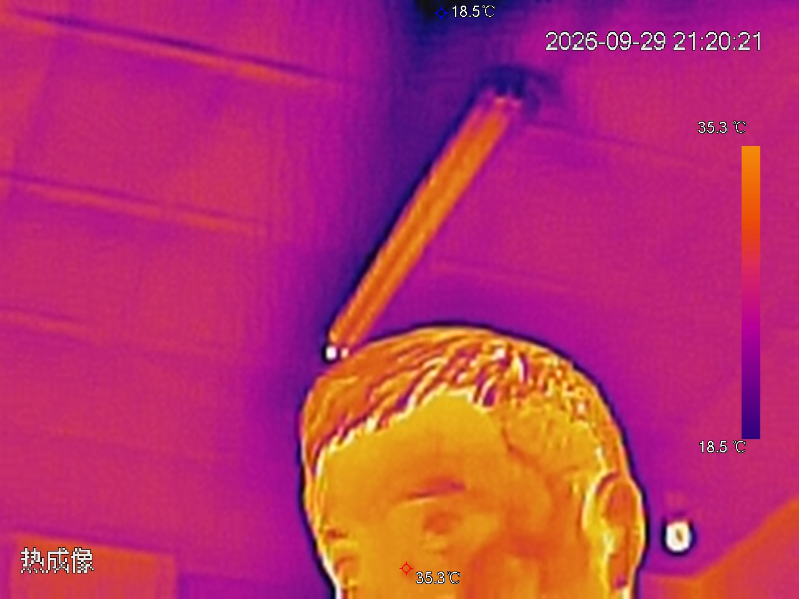
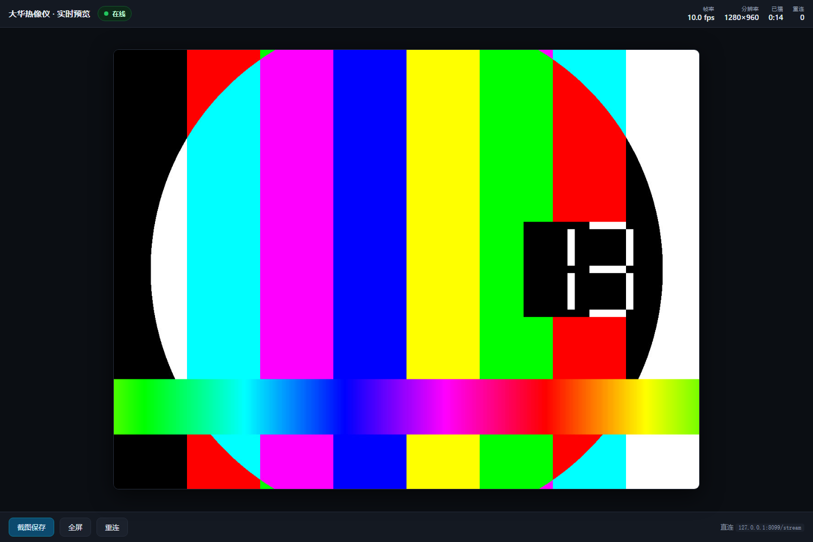

# 大华热像仪 · 实时预览

把 DH-TPC-AT2201 热像仪的画面显示在浏览器里，带状态栏、截图、全屏，以及一个“有损往返”细节实验。

| 摄像头实拍（snapshot.cgi，1280×960） | 界面（ffmpeg 路径，1280×960） |
|---|---|
|  |  |

`samples/` 里还有：真实码流抓帧 `mjpeg_sub1.jpg`（256×192 子码流）、
经服务转发的帧 `via_server.jpg`、以及分辨率对比分析的放大图。

---

## 快速开始

1. **编译** —— 双击 `build.bat`（需要 .NET Framework 4.x）
2. **配置** —— 把 `config.ini.example` 复制为 `config.ini`，填入摄像头 IP、用户名和密码
3. **启动** —— 双击 `启动.bat`，会自动开服务并打开浏览器
4. 关闭浏览器不会停服务，要停就双击 `停止.bat`

> `config.ini` 已被 `.gitignore` 忽略，不会被提交；请勿把真实密码提交到仓库。

浏览器地址：<http://127.0.0.1:8099/>

---

## 摄像头实际情况（实测）

这台 `DH-TPC-AT2201`（序列号 `YOUR-SERIAL`，固件 `2.630.0000000.4.R`）实测出来的能力：

| 项目 | 结果 |
|---|---|
| 认证方式 | **RTSP / HTTP 都是 Digest**，不是 Basic |
| 主码流 | 1280×960 @ 25fps，**H.265**（这版固件 RTSP 不推 MJPG）|
| 子码流 | 256×192 @ 15fps，H.265 |
| 最大分辨率 | **1280×960**；试过设成 1920×1080，相机直接返回 400 |
| HTTP MJPEG | 只有 `subtype=1`（256×192）真的推流；`subtype=0` 返回 200 但收不到帧 |
| HTTP 快照 | `snapshot.cgi` → 1280×960 MJPG，**含清晰温度读数** |
| 通道数 | 只有 channel 1（channel 2 返回 400/401）|

**关键点：这版固件的主码流是 H.265，不再是 MJPG**。程序先用 `-c:v copy` 试零重编码直通，
发现源不是 MJPEG 后自动改为 `-c:v mjpeg` 转码（1280×960 @25fps）。
老固件的 MJPG 主码流仍走直通，不需要改摄像头设置。

> ⚠️ 实测：用 `configManager.cgi` 把 `MainFormat[0].Video.Compression` 改成 `MJPG`
> 虽然返回 `OK`、配置也能读回，但**编码器运行时不会真正生效** —— SDP 报 JPEG，
> 却一帧都不出。改回 H.265 后还要把 `VideoEnable` 置 false 再置 true，编码器才会恢复。

---

## 两条取流路径

程序会自动选，也可以手动指定。

**自动模式的切换逻辑**：每一轮都**先试 RTSP 主码流**，15 秒内没收到画面就**当轮**退回 HTTP 备码流；两个都不行才退避重试（退避最长 15 秒）。
不做「一次性永久降级」—— 否则摄像头恢复后也会一直卡在 256×192 上。

「在线」状态以**是否真的收到画面**为准，不是看 ffmpeg 进程有没有起来。摄像头离线时
ffmpeg 会一直挂着重试而不退出，所以另有一个 15 秒的首帧看门狗把它杀掉重来。

### 主路径：RTSP 主码流（1280×960）

```
# MJPG 源：零重编码直通
ffmpeg -rtsp_transport tcp -i "rtsp://..." -an -c:v copy -f mjpeg pipe:1

# H.265 源（当前这版固件）：转码成 MJPEG
ffmpeg -rtsp_transport tcp -i "rtsp://..." -an -c:v mjpeg -q:v 4 -r 10 -f mjpeg pipe:1
   ↓  按 FFD8/FFD9 拆出完整 JPEG
ThermalView  →  multipart/x-mixed-replace  →  浏览器 
```

程序每轮先试直通；ffmpeg 报 `mjpeg muxer supports only codec mjpeg` 就自动切到转码，
本次进程内不再回退。实测 H.265 转码在 1280×960 下稳定跑满相机源帧率 **25fps**
（码率约 13–14 Mbps，本机 CPU 占用很低）。
优点是分辨率高、OSD 温度文字锐利。**需要 ffmpeg**（见下方「关于 ffmpeg」）。

> 热像探测器本身是 256×192，1280×960 已经是 5× 放大输出，再提高输出分辨率不会增加真实细节；
> 相机侧也确认不接受更高的分辨率。所以 1280×960 就是这台机器的上限。

### 备路径：HTTP MJPEG（256×192）

摄像头自带 `mjpg/video.cgi`，程序在服务端完成 Digest 认证后转发给浏览器。**不需要 ffmpeg**，随时可用，缺点是分辨率只有 256×192。

### 高清截图

界面上的「截图保存」按钮**不走直播流**，而是实时向摄像头要一张原生 `snapshot.cgi` 的 1280×960 图 —— 这样即使直播看着糊，保存下来的温度读数是清晰的。

### 有损往返实验（界面底部按钮）

把当前 1280×960 快照双三次降采样到 256×192，再双三次放大回 1280×960，
与原始快照比较 **PSNR** 和 **SSIM**。用来判断画面中有多少细节真正超过 256×192：

- PSNR 越高、SSIM 越接近 1 → 往返后几乎不变，说明高分辨率主要是插值放大；
- 数值明显下降 → 画面中存在较多高于 256×192 的真实细节（或 OSD 文字占比很高）。

界面上可以切换三种视图：

- **相机原图 1280×960**
- **原始 256×192 像素**（最近邻放大显示，能直接看到像素块）
- **5× 往返重建 1280×960**

也可以直接打开 `/#roundtrip`、`/#roundtrip/low`、`/#roundtrip/recon`。
指标按亮度计算（BT.601），SSIM 用 8×8 分块；缩放和计算都在服务端用 GDI+ 完成，
不需要额外依赖。实测一帧处理约 50ms。

---

## 关于 ffmpeg

RTSP 主路径需要 `ffmpeg.exe`。程序会在以下位置自动查找：

```
tools/ffmpeg/bin/ffmpeg.exe      ← 当前就装在这里（n8.1 lgpl-shared）
tools/ffmpeg.exe
ffmpeg.exe                        （与 ThermalView.exe 同目录）
```

**仓库不包含 ffmpeg 二进制**（`tools/ffmpeg/` 已被 `.gitignore` 忽略）。首次使用请运行 `tools/dl_ffmpeg.sh` 下载，或按下方说明手动安装。没有 ffmpeg 时程序会**自动降级到 HTTP 备路径**并在日志里说明，不会报错退出。

重新下载（换机器时用）：`tools/dl_ffmpeg.sh`

> ⚠️ BtbN 的 `latest` 标签是**滚动更新**的，下载途中如果官方发了新构建，分片就对不上（实测踩到过：总大小从 196MB 变成 198MB）。脚本已加两道防护：合并前比对远端大小、只按编号拼指定分片。

> 这个包是 **lgpl-shared**（76MB，带 DLL）。选它是因为我们只做解复用 + MJPG 直通，不需要 GPL 编码器，体积也只有完整版的一半。**`bin` 整个目录都要留着**，ffmpeg.exe 依赖同目录的 DLL。

---

## 文件说明

```
config.ini.example      配置示例（复制为 config.ini 后填写 IP/密码）
启动.bat / 停止.bat      日常使用
build.bat               重新编译
ThermalView.exe         编译产物（build.bat 生成，仓库不提交）
src/ThermalView.cs      全部源码
www/index.html          界面
tools/dl_ffmpeg.sh      ffmpeg 下载脚本
tools/rtsp_probe.sh     RTSP 握手诊断脚本（排查认证问题用）
tools/485监听.bat       RS-485 总线监听（自动轮询波特率）
tools/serial_monitor.ps1  同上，可读源码版（当前执行策略为 Restricted，需自行调整才能直接跑）
samples/                实测样本图
```

源码只有 `src/ThermalView.cs` 一个文件，用系统自带的 `csc.exe` 编译，**不依赖任何第三方库**：

```bat
build.bat
```

> ⚠️ **改 `.bat` 文件时注意两点**（都踩过）：
> 1. **保持 CRLF 行尾**。`build.bat` 用了 `^` 续行和 `if errorlevel` 块，
>    这些结构在 LF-only 的批处理里会被 cmd.exe 误解析。
> 2. **保持 GBK 编码，不要加 `chcp 65001`**。本机是中文 Windows（代码页 936）。
>    UTF-8 的批处理配 `chcp 65001` 会让 cmd.exe 在读取时丢失字节对齐，
>    中文行会被拆错、报出 `'xxx:' 不是内部或外部命令`。
>
> 用 VS Code 编辑后如果它把文件存成了 UTF-8，需要转回来：
> `iconv -f UTF-8 -t GBK 文件.bat > 临时 && mv 临时 文件.bat`

---

## 命令行参数

```
ThermalView.exe --ip 192.168.1.108 --port 8099
ThermalView.exe --source http        只用 HTTP 备路径，完全不要 ffmpeg
ThermalView.exe --source rtsp        强制走 RTSP
ThermalView.exe --source test        测试图案（无需摄像头，验证界面用）
ThermalView.exe --source ffmpegtest  ffmpeg 自检（无需摄像头，验证 RTSP 代码路径）
```

`--source ffmpegtest` 用 ffmpeg 内置的 `testsrc` 测试源喂给程序，走的是和 RTSP
**完全相同的代码**（启动 ffmpeg → mjpeg 管道 → 拆帧 → 推流），只差输入源不是摄像头。
摄像头不在场时，这是确认 RTSP 那条路径没坏的最好办法。

---

## 接口

| 路径 | 说明 |
|---|---|
| `/` | 界面 |
| `/stream` | 直播流（multipart JPEG）|
| `/snapshot.jpg` | 下载高清快照 |
| `/status` | JSON 状态 |
| `/roundtrip` | 运行有损往返实验，返回 PSNR / SSIM JSON |
| `/roundtrip/original.jpg` | 实验用相机原图（1280×960）|
| `/roundtrip/lowres.png` | 降采样后的 256×192 PNG |
| `/roundtrip/upscaled.jpg` | 放大回 1280×960 的重建图 |

---

## 排查

**IP 变了 / 连不上**

摄像头是 DHCP 分配的，**重启后 IP 会变**。这是最容易踩的坑。

建议在路由器上给它绑定静态 IP（DHCP 保留）。改完 IP 后同步更新 `config.ini`。

确认摄像头在线：

```bash
ping 192.168.1.108
curl --digest -u admin:YOUR_PASSWORD "http://192.168.1.108/cgi-bin/snapshot.cgi?channel=1" -o t.jpg
```

**界面显示「离线，正在自动重连」**

看服务窗口的日志，会用括号标出具体错误（认证失败 / 连接超时 / 流断开）。程序会自动重连，退避到最长 15 秒一次。

**端口被占**

改 `config.ini` 里的 `port`，或 `ThermalView.exe --port 8100`。

程序已开启 `SO_REUSEADDR`，所以「停止后立刻启动」不会因为 TIME_WAIT 连接而绑不上端口
（这个坑踩过：不设的话重启会报「每个套接字地址只允许使用一次」）。

---

## 已验证 / 未验证

**已实测通过：**
- 摄像头连通性、Digest 认证、热成像画面（能看到人像热图与温度刻度）
- HTTP MJPEG 备路径：`/status` 有持续帧率、`/stream` 持续推送、抓帧校验为合法 JPEG
- 界面在 Edge 中完整渲染（状态栏 / 画面 / 按钮），截图为证
- 测试图案模式（`--source test`）
- **RTSP 代码路径**（`--source ffmpegtest`）：ffmpeg 启动、参数构造、1280×960
  mjpeg 输出解析、拆帧、推流全部正常，稳定 10.0fps
- **真实 RTSP 输入**（新机 `192.168.1.108`）：H.265 源自动转码为 MJPEG，
  `/status` 报 1280×960、稳定 25fps，`/stream` 与 `/snapshot.jpg` 均正常
- **有损往返实验**（`--source test` 下验证）：`/roundtrip` JSON 指标、三视图切换、
  256×192 PNG 与 1280×960 重建 JPEG 输出均正常

**未验证：**
- 真实热像画面下的往返实验数值（需相机在线；界面、接口和图片链路已用测试图案验证）
- 摄像头断电重启后是否能稳定自动重连（目前只验证了手动 `停止.bat` / `启动.bat`）

**后续可以做的：**
- 摄像头是 DHCP 的，IP 一变就要改配置。除了在路由器上绑定静态 IP，
  还可以做一层大华 UDP 发现（37810 端口广播），自动找到摄像头。
- MJPEG 拆帧目前是按 `FFD8`/`FFD9` 扫描。这台机器输出的 JPEG 不含 EXIF 缩略图，
  所以没问题；如果以后换的摄像头会在 JPEG 里嵌缩略图，需要改成按段解析。

## 许可

MIT License，详见 [LICENSE](LICENSE)。
